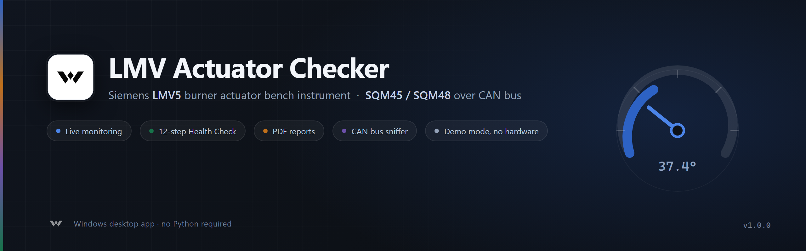
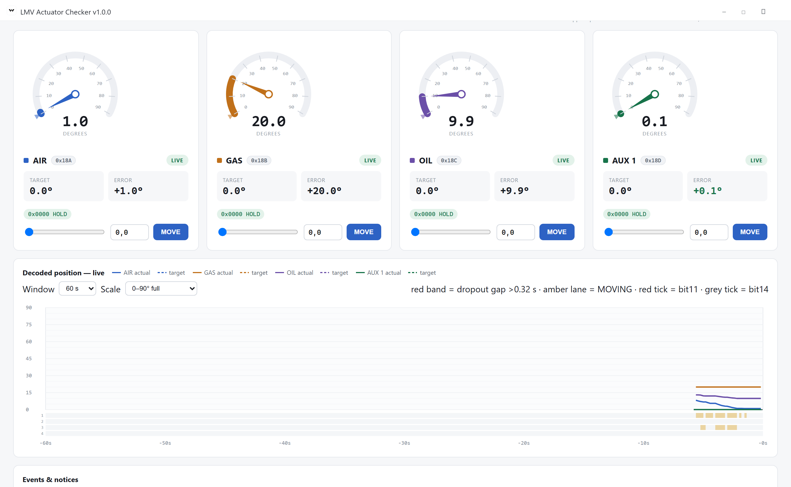
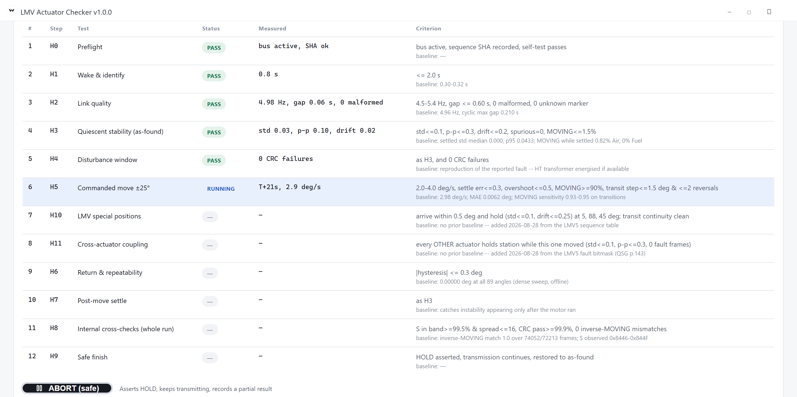
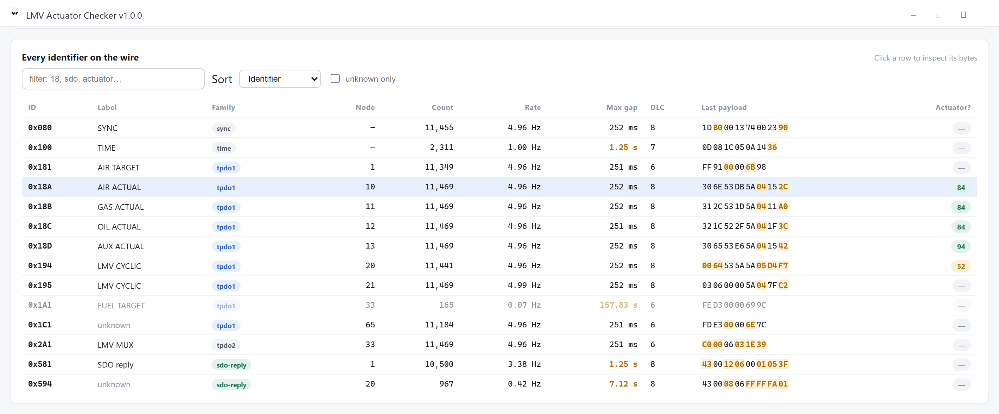

  
  
  
  

---

**LMV Actuator Checker** is a Windows desktop app for testing **Siemens SQM45 / SQM48 actuators** on an **LMV5** burner control system, over the CAN bus.

Plug in a USB-CAN adapter and you can watch every actuator on the bus live, command one to a position on an isolated bench, run an automated 12-step health check that ends in a PASS/FAIL PDF report, or use the raw sniffer to decode a bus you've never seen before.

It runs offline, needs no Python install, and ships with recorded demo traffic so **you can try the whole thing with no hardware at all.**

---

## Download

**[⬇ Download LMVActuatorCheckerSetup-1.0.0.exe](https://github.com/wise78/lmv-actuator-checker/releases/latest)** (~34 MB)

1. Download the installer from the link above
2. Run it and click through the wizard
3. Launch **LMV Actuator Checker** from the Start Menu

That's it. No Python, no dependencies, no internet connection needed after install.

> **First launch** shows a one-time safety notice and a driver help screen. You can tick *"I'm trying the demo first"* and explore the app immediately without any adapter plugged in.

---

## What it does

### Dashboard — every actuator at a glance
Cards appear automatically as actuators are discovered on the bus, each with a live 0–90° gauge, target, error and status. The shared chart plots them all against time, flagging dropouts, movement and status bits.

### Health Check — 12 automated steps, one PDF verdict
Enter a serial number and technician name, pick an actuator, and the app runs the full H0–H11 sequence: wake, link quality, quiescent stability, a disturbance window, commanded moves, LMV special positions, cross-actuator coupling, and a safe finish. The result is a signed-off PDF report you can hand to a customer.

### Raw Sniffer — a generic CAN analyser
Doesn't assume you're looking at an LMV5 at all. It scores every identifier on the wire for how much it looks like actuator feedback, maps the controller's node address space, and shows you exactly which bits move in each frame.

### Servo Checker — one actuator, full control
Role tabs, a commanded-setpoint slider, target-vs-feedback charting, and a frame inspector that decodes every field of the raw 8-byte CAN frame behind the numbers.

---

## Supported hardware

| Adapter | Driver | USB ID |
|---|---|---|
| **ICP DAS tM-7565** USB-to-CAN | ICP DAS tM-7565 driver | `1B5C:0109` |
| **ESP32 + MCP2515** CAN bridge | Silicon Labs CP210x VCP | `10C4:EA60` |

Both connect as a virtual COM port at 115200 baud. The CAN bus itself runs at **50 kbps**, set on the adapter hardware (not in the app). Wiring diagrams for both adapters are in the documentation.

---

## ⚠ Safety

This tool talks directly to CAN bus hardware. On a live burner control system it can, if put into **Keep alive** mode, transmit onto a safety-relevant bus.

- **Listen only** (the default) is receive-only — nothing is ever transmitted. Safe on any bus, including ones you don't own.
- **Keep alive** unlocks transmit, and is for a **de-fuelled, de-ignited, mechanically isolated bench only**.

Two independent gates stand between you and a transmitted frame, and every page carries a HOLD button (`Esc` / `Space`) plus a press-and-hold bus shutdown. **Section 4 of the documentation covers all of this — read it before connecting to real hardware.**

---

## Documentation

📘 **[Application Documentation (PDF)](docs/LMV%20Actuator%20Checker%20-%20Application%20Documentation.pdf)** — 38 pages, written for field technicians

Covers installation, first launch, the safety system, all four pages screen-by-screen, the full Health Check workflow, keyboard shortcuts, troubleshooting, and wiring reference diagrams. Also available as [DOCX](docs/LMV%20Actuator%20Checker%20-%20Application%20Documentation.docx).

Wiring references:
- [USB/CAN adapter wiring](docs/CANtoBUS%20Adapter%20Wiring%20advice.png) — tM-7565 and ESP32 + MCP2515
- [Isolated bench wiring](docs/Servo%20Checker%20Isolated%20Bench%20Wiring.png) — transformer and 4-actuator CAN daisy chain

---

## Try it without hardware

The installer bundles two recordings of real bus traffic that replay as if they were live:

- **4 actuators** (air, gas, oil, aux1) — the full dashboard with a complete roster
- **2 actuators, commanded move 30° → 90°** — shows a real transit on the charts

Pick *"Try a demo (no hardware)"* on the connect screen. Nothing is ever transmitted in this mode, so it's safe to run anywhere.

---

## License

Released under the [MIT License](LICENSE) — free to use, modify and distribute, provided the copyright notice is kept. Note the warranty disclaimer: this software is provided **as is**, with no guarantee of fitness for any particular purpose. It is a diagnostic instrument, not a certified safety device.

---

  Built for the WiseTech bench · Windows desktop app · v1.0.0

